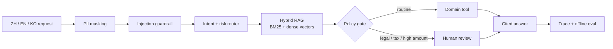

# CrossBorder AI Support Agent

A production-shaped, multilingual AI support workflow that combines **agent
orchestration, hybrid RAG, model routing, tool calling, guardrails and
evaluation**. It handles routine logistics/account/refund questions while
forcing legal, tax and high-value cases into an auditable human-review path.

The repository is intentionally portfolio-safe: all tickets, tools and results
are deterministic simulations. It contains no customer records, credentials or
claims of production deployment.

## Why this is more than a chatbot



The LLM is deliberately outside the trust boundary. Local code masks PII,
selects the risk route, controls tools and validates citations first. A live
model can improve wording, but cannot downgrade a premium route, bypass human
approval or cite documents that were not retrieved.

## Implemented capabilities

- Manager-style support workflow with explicit tool-call trace.
- Chinese, English and Korean intent/risk routing.
- Hybrid retrieval combining BM25 sparse search and dense vector similarity.
- Dependency-free hashing embeddings for CI plus optional OpenAI embeddings.
- Knowledge filtering by intent/language and source-level citations.
- Tool simulations for shipment lookup, refund policy and account recovery.
- Human-in-the-loop gate for legal, tax and high-value requests.
- Prompt-injection detection, typed PII masking and citation allow-listing.
- Optional OpenAI Agents SDK runtime with specialist handoffs and privacy-safe
  tracing configuration.
- FastAPI, CLI, Docker, GitHub Actions and two reproducible evaluation suites.

## Quick start

```bash
python -m venv .venv
# Windows: .venv\Scripts\activate
# macOS/Linux: source .venv/bin/activate
python -m pip install -e ".[dev]"
python -m unittest discover -v
```

Run the grounded agent without an API key:

```bash
support-agent --text "请查询订单 ORD-12345 的物流" --amount-usd 50
```

Run a high-risk case:

```bash
support-agent --text "This contract breach may become a lawsuit" --amount-usd 2500
```

The JSON result includes route, model tier, citations, retrieval scores,
guardrail flags and every local tool decision.

Start the API:

```bash
uvicorn core.api:app --host 127.0.0.1 --port 8000
curl -X POST http://127.0.0.1:8000/v1/support/resolve \
  -H "Content-Type: application/json" \
  -d '{"text":"Where is my parcel?","request_id":"demo-1"}'
```

Open `http://127.0.0.1:8000/docs` for the generated OpenAPI UI. A containerized
demo is also available with `docker compose up --build`.

## Optional live multi-agent path

The default path is fully offline and deterministic. To run specialist handoffs
through the OpenAI Agents SDK:

```bash
python -m pip install -e ".[ai]"
set OPENAI_API_KEY=...                 # PowerShell: $env:OPENAI_API_KEY="..."
```

Call `core.live_agent.run_live(...)` from an authorized environment. It first
builds a local policy envelope, then gives only masked metadata and retrieved
source identifiers to the live model. Sensitive trace payloads are disabled.

## Evaluation

```bash
python -m core.benchmark --count 600 --output benchmark/results.json
python -m core.agent_eval --output benchmark/agent-eval-results.json
```

The routing benchmark uses 600 deterministic synthetic tickets. The agent
evaluation separately checks retrieval recall@3, citation validity, high-risk
human review and direct prompt-injection detection. These are controlled
regression signals, not production accuracy claims.

| Metric | Controlled result |
|---|---:|
| Synthetic tickets | 600 |
| Intent accuracy | 90.00% |
| High-risk premium recall | 100.00% |
| Modeled cost reduction | 31.67% |
| Agent eval cases | 6 |
| Retrieval recall@3 | 100.00% |
| Citation validity | 100.00% |

## Repository layout

```text
core/agent.py              Agent workflow, tools and immutable policy envelope
core/rag.py                BM25 + dense hybrid retriever and embedding adapters
core/guardrails.py         Injection detection and citation validation
core/live_agent.py         Optional OpenAI Agents SDK specialist handoffs
core/api.py                FastAPI service
core/agent_eval.py         Retrieval/grounding/safety evaluation
core/cost_router.py        Risk-first model routing
knowledge/articles.json    Versioned multilingual knowledge base
benchmark/                 Synthetic datasets and committed eval results
tests/                     Unit, API, retrieval and safety tests
```

## Engineering decisions

1. **Policy before model.** A generative answer can never weaken a deterministic
   high-risk or high-amount rule.
2. **RAG with evidence.** Every answer exposes retrieved document identifiers
   and separate sparse/dense scores.
3. **Offline first.** CI and reviewers can exercise the complete workflow with
   no paid service. Live embeddings and handoffs are adapters, not hidden
   requirements.
4. **Untrusted by default.** User text and retrieved content are treated as
   data; tool arguments, citations and high-impact actions are constrained.
5. **Honest evaluation.** Synthetic metrics demonstrate reproducibility, not
   production model quality.

## Documentation

- [Architecture and trust boundary](docs/architecture.md)
- [Benchmark methodology](docs/benchmark-methodology.md)
- [Interview evidence and claim boundaries](docs/interview-evidence.md)
- [Resume wording and interview pitch](docs/resume-and-interview.md)

## Production gaps

Before production use, add tenant identity/RBAC, durable queues, a real order
adapter with least-privilege credentials, rate limits, provider retries and
circuit breakers, a managed vector store, OpenTelemetry export, feedback
workflows, retention controls, authorized real-data evaluation and red-team
testing.

## Author

Liu Minghao — AI application and solution engineering portfolio
GitHub: [@lminghao233-tech](https://github.com/lminghao233-tech)

## License

MIT
